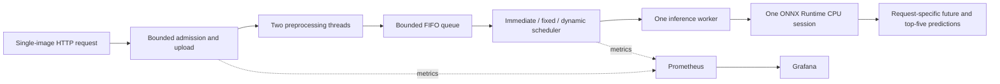
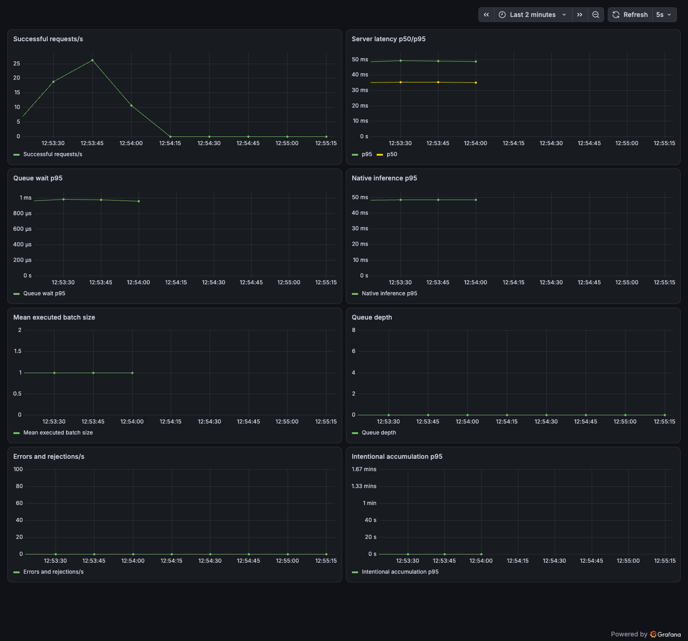

# InferenceOps

A reproducible CPU model-serving service with bounded batching, operational telemetry, and a measured throughput–latency study. Built with **FastAPI, ONNX Runtime, Docker Compose, Prometheus/Grafana, and Locust**.

**Finding:** Immediate FIFO is the sensible default for this ResNet-18 CPU workload. Dynamic batching improved mean saturation throughput by about **3%**, but added latency at lighter loads and did not improve burst throughput. This is an engineering study, not a new batching algorithm or a production reliability claim.

## Architecture



- One process/session/worker; fixed ONNX threading. All native image/model work stays off the event loop.
- Immediate dispatch, fixed periodic windows, or fullness/oldest-request-triggered dynamic batching.
- Bounded request bytes, decoded/resize dimensions, preprocessing concurrency, admission and prepared queue.
- Absolute server deadlines, cancellation tokens, explicit errors, and graceful queue draining. Already-running native calls cannot be interrupted.

## Quickstart

Requirements: **CPython 3.11**, Docker with Compose, and an **ARM64 host**. The measured deployment uses Linux ARM64 containers on Apple Silicon. Allocate at least 4 CPUs and 4 GiB to Docker; the API itself is limited to 2 CPUs / 1 GiB. First setup needs internet for dependencies, images and public weights.

```sh
python3.11 -m venv .venv
source .venv/bin/activate
python -m pip install -r requirements-dev.txt
export TORCH_HOME=.cache/torch
export SSL_CERT_FILE="$(python -m certifi)"
python -m models.export

docker compose up --build -d --wait
curl --fail http://127.0.0.1:18080/health/ready
curl --fail http://127.0.0.1:18080/model/info
curl --fail http://127.0.0.1:18080/predict \
  -H 'Content-Type: image/png' --data-binary @benchmarks/fixtures/input.png
```

The included PNG is generated noise for reproducible serving measurements; use your own JPEG/PNG for semantic predictions. `/predict` accepts raw encoded bytes, not multipart. Responses include a request UUID, model version, top-five labels/probabilities, executed batch size, preprocessing time, total queue wait, intentional accumulation and native inference duration. `/health/live`, `/health/ready`, `/model/info`, `/metrics`, and `/docs` are available.

- Grafana: [dashboard](http://127.0.0.1:13000/d/inferenceops/inferenceops), anonymous local Viewer.
- Prometheus: [targets](http://127.0.0.1:19090/targets).
- Stop: `docker compose down -v`.

All ports bind to localhost. The model is generated locally and verified at startup; model binaries are not in Git. [Provenance and licensing](THIRD_PARTY_NOTICES.md).



## Verification and reproduction

```sh
# Use the environment and TORCH_HOME from quickstart.
python -m pip check
PYTEST_DISABLE_PLUGIN_AUTOLOAD=1 python -m pytest
python -m models.validate --checkpoint .cache/torch/hub/checkpoints/resnet18-f37072fd.pth
python -m scripts.smoke

# Analyze the published per-run numeric evidence; no new study required.
python -m pip install -r requirements-benchmark.txt
python -m benchmarks.verify_published
INFERENCEOPS_RESULTS_DIR=results/published python -m benchmarks.analyze
```

The **43-test suite** covers numerical parity at batches 1/2/4/8, exact preprocessing agreement on generated fixtures, concurrent result mapping, queue bounds, policy dispatch, deadlines, cancellation, shutdown and metrics. CI runs tests, checks syntax and published accounting, builds the ARM64 image, and exercises inference/monitoring. [Full reproduction instructions](docs/reproduction.md).

## Results

42 short runs, three repetitions, identical seeded open-arrival traces and fixture bytes, same ARM64 image and 2-CPU quota. The **100 ms client-observed evaluation target** is distinct from the **500 ms server deadline**. Values below are run means ± sample SD at saturation.

| Policy | Successful requests/s | Within 100 ms requests/s | Successful p95, ms | Rejected / offered |
|---|---:|---:|---:|---:|
| Immediate | 41.27 ± 1.12 | 7.14 ± 4.88 | 223.42 ± 39.53 | 24.7% |
| Fixed | 37.59 ± 2.51 | 6.71 ± 1.15 | 245.07 ± 46.36 | 32.0% |
| Dynamic | 42.54 ± 1.34 | 10.64 ± 3.38 | 189.11 ± 6.75 | 23.1% |

**7,685 offered = 5,834 successes + 1,851 rejections**, with zero generator misses, unexpected errors or timeouts in these comparison runs. Rejections remain in the offered-work denominator. Failure-inclusive latency is never used to claim a policy win.


At light load batching increases latency without increasing throughput; immediate also leads burst throughput. Variation overlaps, and the saturation gain is modest. [Final performance summary](docs/performance.md) · [per-run data](results/published/runs.csv) · [fairness plot](docs/images/fairness.png).

Limitations: one local CPU-limited Docker VM, one generated load fixture, six-second windows and three repeats. Results are not an ImageNet accuracy evaluation or a hardware-independent guarantee. Upload/handler/native shutdown have different lifecycle bounds; read [operational semantics](docs/operations.md). No GPU, extra models, distributed scheduling or cloud deployment is included.

## Resume bullets

- Built a CPU inference service with bounded batching, deadline and queue controls, and Prometheus/Grafana telemetry using FastAPI, ONNX Runtime and Docker Compose.
- Evaluated three scheduling policies across 42 controlled runs and 7,685 offered requests; measured a modest 3% saturation throughput gain from dynamic batching while documenting light-load latency and burst-throughput regressions.

Project code is [MIT licensed](LICENSE); upstream code, images and pretrained weights retain their own terms. See [attribution and dependency inventory](THIRD_PARTY_NOTICES.md).
