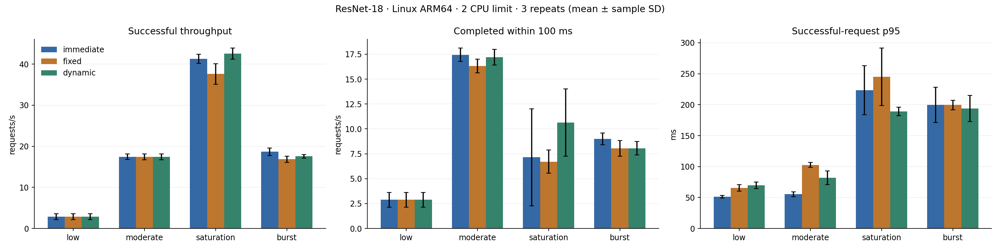
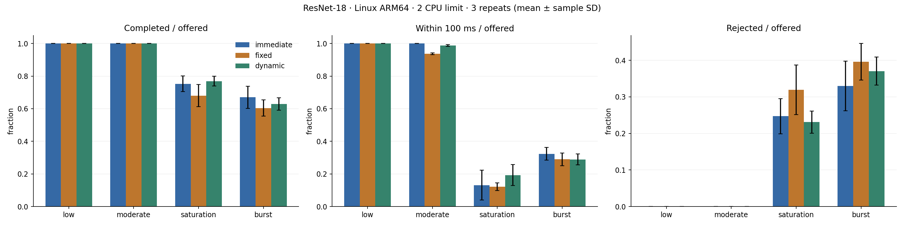
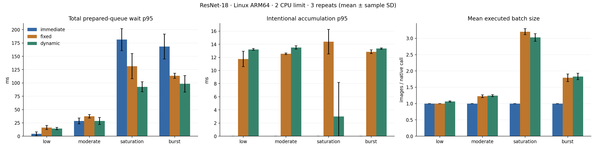

# Performance findings

Measured on one Apple Silicon local Docker VM running Linux ARM64, with a 2-CPU quota / 1 GiB API limit, one session, one worker, intra-op two/inter-op one, and two preprocessing workers. Monitoring services each have a 0.5-CPU quota / 256 MiB limit. No GPU or alternate model is used. CPU quotas are not exclusive core affinity.

A 39.60 requests/s sequential calibration set common arrival profiles. Across 42 six-second runs (three repetitions, rotated policy order, identical seeds/PNG fixture), 7,685 requests were offered and sent: 5,834 successful, 1,851 rejected, zero missed/timeouts/unexpected errors. Every comparison run drained to zero active and queued work. Successful outputs matched the fixture reference and request IDs were unique. The 100 ms evaluation target is separate from the 500 ms server deadline.

| Saturation policy | Successes/s, mean ± SD | Within 100 ms/s, mean ± SD | Successful p95 ms, mean ± SD | Rejected/offered | Mean batch |
|---|---:|---:|---:|---:|---:|
| Immediate | 41.27 ± 1.12 | 7.14 ± 4.88 | 223.42 ± 39.53 | 24.7% | 1.00 |
| Fixed | 37.59 ± 2.51 | 6.71 ± 1.15 | 245.07 ± 46.36 | 32.0% | 3.20 |
| Dynamic | 42.54 ± 1.34 | 10.64 ± 3.38 | 189.11 ± 6.75 | 23.1% | 3.03 |

Dynamic gains about 3% mean saturation throughput versus immediate, with lower mean successful p95 but overlapping run variation and substantial uncertainty in 100 ms completion rate. This is a modest workload-specific gain, not statistical proof of superiority. At low load, successful p95 is 51.4 ms immediate versus 65.6/70.0 ms fixed/dynamic, with equal throughput. At moderate load immediate p95 is 55.5 ms versus 102.6/82.0 ms. In bursts immediate leads throughput (18.66 versus 17.55 dynamic) and rejects less work (33.0% versus 37.1%). Immediate remains the sensible default.

The bounded batch-four/5 ms sensitivity check yields fixed 41.50 ± 1.65 and dynamic 42.51 ± 1.01 requests/s at saturation; their p95 values are 191.85 ± 10.90 and 185.88 ± 3.24 ms. Configuration matters, but dynamic throughput changes little. No further tuning or hardware/model changes were used to manufacture a gain.

Latency is reported for successful requests alongside rejection/offered and deadline-compliant/offered fractions. In fixed burst repeat two, an all-sent median of about 34 ms coexists with successful median about 140 ms and 45% rejections. Mixed latency alone would reward dropping work. No saturation policy serves most offered work within 100 ms.

Intentional accumulation is a subset of total queue wait. Dynamic saturation often has zero deliberate waiting while still experiencing backlog behind busy inference. Native batch duration is not per-image latency. Generator CPU stayed below 0.138 of one host core, maximum dispatch lag was about 21 ms, and all offered work was accounted for. API cgroup usage reached its two-core quota; throttling was present and is recorded in the numeric run data.

Separate lifecycle probes exercised deadline overload (eight 504s and 32 rejections), abandoned HTTP reads with admitted work draining, and graceful shutdown under load (nine successes/31 rejections; about 0.50 s shutdown). A separate 12-user Locust check produced 5,119 requests: 270 successes and 4,849 overload rejections. These probes are not mixed into the policy-comparison dataset.

All mean/SD values are across three runs, not correlated individual requests. One host, one generated fixture, short windows, thermal/scheduling variability and co-located monitoring limit generalization. The fixture is not an accuracy dataset. This supports a complete inspectable serving artifact, not production guarantees. [Numeric run data](../results/published/runs.csv) and [protocol](reproduction.md) are sufficient to recompute the published summaries; complete private development traces are intentionally not published.
